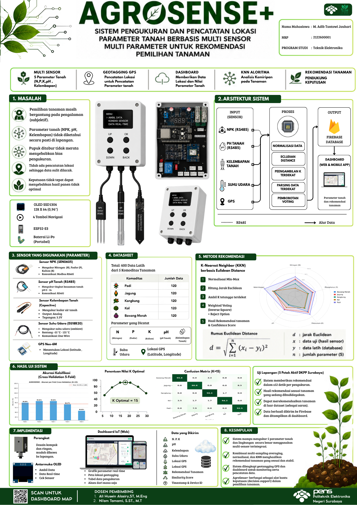
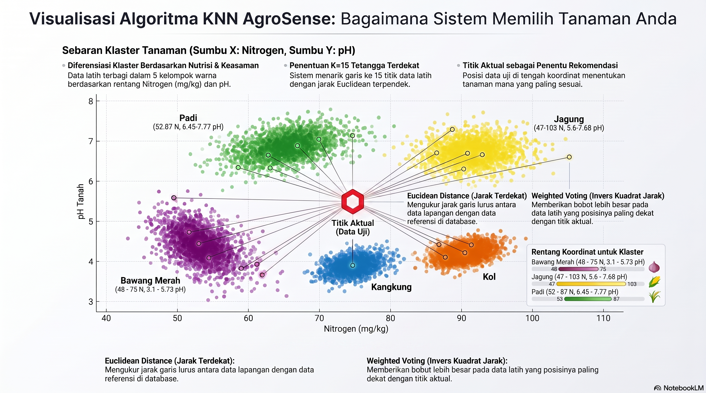
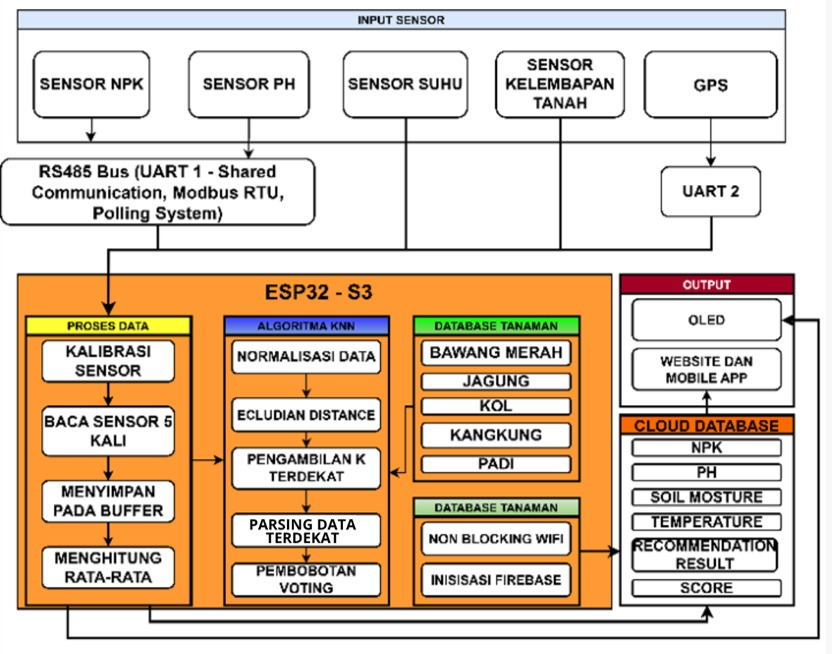
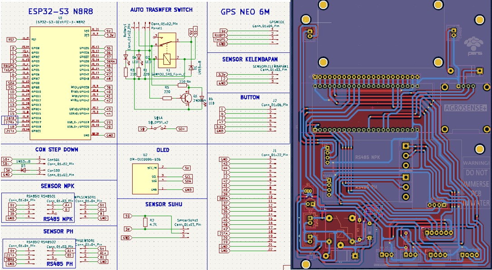
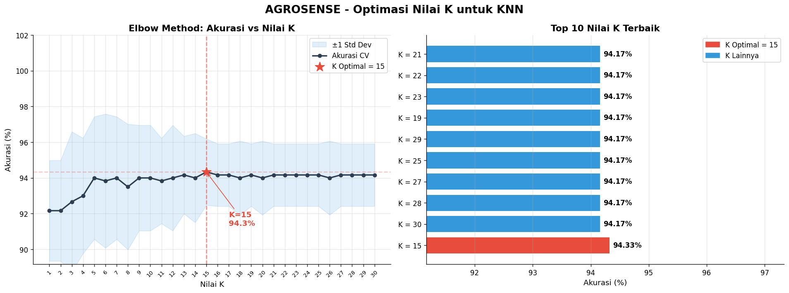
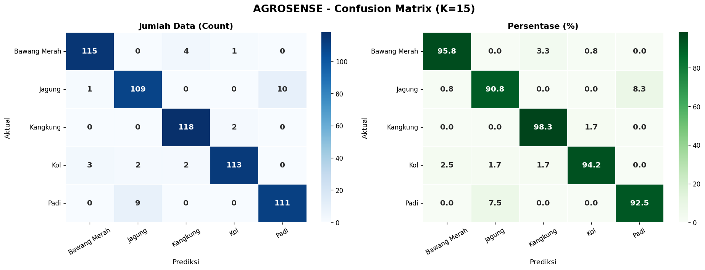

  

<h1 align="center">AgroSense</h1>

  Portable Soil Profiling System with On-Device KNN-Based Crop Recommendation

  
  
  

  <a href="https://agrosensepens.netlify.app/">Live Dashboard</a> ·
  <a href="#system-architecture">Architecture</a> ·
  <a href="#results">Results</a> ·
  <a href="#getting-started">Getting Started</a>

---

## Description

AgroSense adalah alat ukur profil tanah berbasis ESP32-S3 yang membaca lima parameter tanah — Nitrogen, Fosfor, Kalium, pH, dan kelembapan — lalu langsung memberikan rekomendasi tanaman di lapangan lewat algoritma Weighted K-Nearest Neighbor yang berjalan on-device, tanpa perlu koneksi internet saat pengukuran. Setiap titik ukur dicatat lokasinya lewat GPS dan tersinkron otomatis ke dashboard web via Firebase.

Sistem ini dibangun untuk menjawab masalah konkret: petani sering menentukan tanaman berdasarkan kebiasaan, bukan kondisi tanah yang terukur. Basis pengetahuan sistem terdiri dari 600 data latih hasil pengukuran lapangan pada lima kelas tanaman: padi, jagung, bawang merah, kangkung, dan kol, yang dikumpulkan langsung dari lahan aktif binaan Dinas Ketahanan Pangan dan Pertanian Kota Surabaya. Setiap pengukuran baru diklasifikasikan dengan menghitung jarak Euclidean terhadap seluruh data latih tersebut, lalu menentukan tanaman yang paling sesuai lewat weighted voting berbasis kedekatan jarak. Nilai K optimal (K=15) ditentukan melalui validasi silang lima-fold (Elbow Method), menghasilkan akurasi klasifikasi 94,33%.

Proyek ini dikerjakan sebagai Proyek Akhir D4 Teknik Elektronika, Politeknik Elektronika Negeri Surabaya.

---

## Features

- Akuisisi lima parameter tanah (NPK, pH, kelembapan) plus suhu dan GPS dalam satu perangkat
- Sensor multiplexing — dua sensor Modbus/RS485 berbagi satu jalur serial
- Multi-sampling averaging untuk mengurangi bias akibat sebaran pupuk tidak merata
- Klasifikasi KNN on-device dengan weighted voting dan reject option
- Geotagging otomatis pada setiap pengukuran
- Sinkronisasi real-time ke dashboard web via Firebase

---

## Theoretical Background

### Parameter Kesuburan Tanah

Sistem mengukur lima parameter yang secara ilmiah menentukan kesuburan tanah dan kesesuaian tanaman:

- **Nitrogen (N), Fosfor (P), Kalium (K)** — unsur hara makro primer. N berperan pada pertumbuhan vegetatif dan fotosintesis, P pada transfer energi (ATP) dan pembentukan akar, K pada regulasi air dan ketahanan tanaman terhadap penyakit.
- **pH Tanah** — indikator ketersediaan unsur hara. Pada rentang netral (6,0–7,0), sebagian besar unsur hara mudah diserap tanaman; pada pH rendah, aluminium menjadi toksik dan NPK kurang tersedia; pada pH tinggi, unsur mikro seperti Fe dan Zn sulit diserap.
- **Kelembapan Tanah** — memengaruhi penyerapan air dan hara oleh akar. Kekurangan air membatasi penyerapan hara, sementara kondisi terlalu basah menyebabkan aerasi buruk dan kekurangan oksigen pada akar.

### Prinsip Kerja Sensor

| Sensor | Prinsip Kerja |
|---|---|
| NPK (SEN0605) | Dua elektroda stainless steel mengalirkan arus kecil ke tanah; konduktivitas ion yang terukur berbanding lurus dengan konsentrasi N, P, K. Data dikirim via Modbus-RTU (RS485) dalam satuan mg/kg. |
| pH | Prinsip elektrokimia — dua probe mendeteksi beda potensial listrik akibat konsentrasi ion H⁺ dalam larutan pori tanah, dikonversi menjadi nilai pH via RS485/Modbus-RTU. |
| Soil Moisture (Capacitive V2.0) | Perubahan kapasitansi akibat perubahan konstanta dielektrik tanah — semakin tinggi kadar air, semakin besar kapasitansi. Dibaca via ADC 12-bit ESP32-S3. |
| DS18B20 | Termometri semikonduktor berbasis protokol 1-Wire, resolusi 9–12 bit. |
| NEO-6M GPS | Prinsip trilaterasi terhadap minimal 4 satelit, output format NMEA 0183 via UART, update 1 Hz. |

### Sensor Multiplexing

ESP32-S3 hanya memiliki satu jalur *Hardware Serial* (UART1) yang tersisa untuk dua sensor Modbus/RS485 (NPK dan pH), setelah UART0 dipakai Serial Monitor dan UART2 dipakai GPS. Sistem mengatasi keterbatasan ini dengan mekanisme *sensor multiplexing* — NPK dan pH berbagi UART1 secara bergantian dengan isolasi sinyal ketat untuk mencegah interferensi antar sensor.

### Multi-Sampling Averaging

Praktik pemupukan petani yang tidak merata (pupuk padat ditabur di dekat zona perakaran, bukan dilarutkan) menyebabkan konsentrasi NPK lokal sangat tidak homogen. Sensor berbasis titik (*point-based*) rawan bias jika tidak tepat berada di area sebaran pupuk. Sistem menerapkan **lima kali pengulangan pembacaan** per siklus pengukuran pada titik berbeda dalam satu area, kemudian dirata-ratakan untuk meminimalkan galat akibat variabilitas spasial ini.

### K-Nearest Neighbor (KNN)

KNN adalah algoritma klasifikasi berbasis instans (*instance-based*) dan non-parametrik — tidak membuat asumsi terhadap distribusi data, sehingga fleksibel untuk data multidimensi. Klasifikasi profil tanah baru ditentukan berdasarkan kemiripannya terhadap K data latih terdekat dalam basis data.

**Jarak Euclidean** antara vektor data uji dan vektor data latih dihitung sebagai:

$$d(x, y) = \sqrt{\sum_{i=1}^{n} (x_i - y_i)^2}$$

dengan `x` = vektor hasil pengukuran sensor (N, P, K, pH, kelembapan), `y` = vektor data latih, dan `n = 5` dimensi parameter. Semakin kecil `d`, semakin tinggi kesesuaian antara kondisi tanah aktual dan data latih tanaman tersebut.

**Weighted Voting** — setiap tetangga diberi bobot berbasis invers kuadrat jarak, sehingga tetangga yang lebih dekat berkontribusi lebih besar terhadap keputusan klasifikasi:

$$w_i = \frac{1}{d_i^2}$$

**Reject Option** — apabila tidak ada tetangga yang memenuhi ambang batas jarak tertentu, sistem mengeluarkan status *"Tidak Dikenali"* alih-alih memaksakan rekomendasi yang tidak relevan. Seluruh proses klasifikasi berjalan langsung di ESP32-S3 terhadap 600 data latih yang tersimpan di PROGMEM, tanpa ketergantungan koneksi internet.

Seluruh fitur dinormalisasi terlebih dahulu menggunakan **Min-Max Scaling** sebelum perhitungan jarak, agar parameter dengan rentang nilai besar (seperti NPK dalam mg/kg) tidak mendominasi parameter dengan rentang kecil (seperti pH).

  

Visualisasi klasterisasi 5 kelas tanaman berdasarkan Nitrogen dan pH, serta proses pemilihan K=15 tetangga terdekat lewat Euclidean distance dan weighted voting

---

## System Architecture

  

---

## Hardware Components

| Component | Function | Interface |
|---|---|---|
| ESP32-S3 | Main microcontroller | — |
| SEN0605 (DFRobot) | NPK sensor | RS485/Modbus |
| VMS-3000 | Soil pH sensor | RS485/Modbus |
| Capacitive Soil Moisture V2.0 | Soil moisture | Analog |
| DS18B20 | Temperature | OneWire |
| NEO-6M | GPS module | UART |
| SSD1306 | OLED display | I2C |

---

## Results

| Metric | Value |
|---|---|
| KNN classification accuracy (K=15, 5-Fold CV) | 94.33% |
| Matthews Correlation Coefficient | 0.929 |
| ROC-AUC (multi-class) | 0.9947 |
| NPK sensor calibration (R²) | > 0.97 |
| pH sensor calibration (R²) | 0.9671 |
| GPS accuracy (open area) | ±2.5 m |
| Inference time per measurement | ~12 s |
| Training data | 600 points, 5 crop classes |

Rekomendasi yang dihasilkan sistem mencerminkan kemiripan profil tanah terhadap data latih dan berfungsi sebagai alat bantu keputusan, bukan pengganti keputusan agronomis final.

---

## Getting Started

### Firmware

Firmware berjalan di ESP32-S3 dengan skema multitasking FreeRTOS — enam task berjalan paralel (pembacaan kelembapan, suhu, GPS, NPK, pH, dan update OLED) dengan mutex untuk mengamankan jalur serial RS485 yang dipakai bergantian oleh sensor NPK dan pH.

**Alur pengukuran:**

1. **Akuisisi & kalibrasi sensor** — nilai mentah tiap sensor dikonversi ke satuan fisis lewat regresi linear hasil kalibrasi laboratorium:

$$N = 0.2141 \cdot N_{raw} + 40.688 \quad\quad P = 0.0414 \cdot P_{raw} + 15.517 \quad\quad K = 0.0784 \cdot K_{raw} + 29.932$$

$$pH = 0.8914 \cdot pH_{raw} + 1.1576$$

   Kelembapan tanah dipetakan dari rentang ADC kering–basah, lalu dihaluskan dengan *Exponential Moving Average* untuk meredam noise pembacaan:

$$M = \frac{ADC_{dry} - ADC_{raw}}{ADC_{dry} - ADC_{wet}} \times 100 \quad\quad EMA_t = \alpha \cdot M_t + (1-\alpha) \cdot EMA_{t-1}, \ \ \alpha = 0.2$$

*(M dinyatakan dalam persen kelembapan, %)*

2. **Multi-sampling** — setiap parameter diukur lima kali pada titik berbeda dalam satu area, lalu dirata-ratakan sebelum masuk ke tahap klasifikasi.

3. **Normalisasi Min-Max** — kelima parameter hasil rata-rata dinormalisasi terhadap rentang nilai seluruh data latih agar skalanya sebanding:

$$x_{norm} = \frac{x - x_{min}}{x_{max} - x_{min}}$$

4. **Klasifikasi KNN** — jarak Euclidean dihitung terhadap 600 data latih yang disimpan di flash (PROGMEM), dibaca satu per satu agar hemat RAM:

$$d = \sqrt{(N_1{-}N_2)^2 + (P_1{-}P_2)^2 + (K_1{-}K_2)^2 + (pH_1{-}pH_2)^2 + (M_1{-}M_2)^2}$$

   K=15 tetangga terdekat diambil, lalu diberi bobot berbanding terbalik dengan kuadrat jaraknya:

$$w_i = \frac{1}{d_i^2}$$

5. **Reject option & confidence score** — jika tetangga terdekat berjarak lebih dari 0.30, sistem mengeluarkan status *"Tidak Dikenali"*. Skor keyakinan akhir dihitung dari proporsi suara terbanyak, dikalikan penalti berdasarkan berapa banyak dari K tetangga yang benar-benar valid (berada dalam ambang 0.30):

$$confidence = \left(\frac{\sum w_i \ \text{(kelas terpilih)}}{\sum w_i \ \text{(semua tetangga)}}\right) \times \frac{validCount}{K} \times 100$$

*(confidence dinyatakan dalam persen, %)*

Seluruh proses ini berjalan sepenuhnya on-device tanpa koneksi internet; hasil klasifikasi baru dikirim ke Firebase saat pengguna memilih menu upload.

<a href="./File firmware">File firmware »</a>

### Schematic

  

<a href="./assets/scematic.jpeg">File Scematic »</a>

### Model Evaluation

Evaluasi difokuskan pada dua hal: menentukan nilai K yang paling optimal, dan mengukur seberapa akurat sistem mengklasifikasikan profil tanah berdasarkan 600 data latih yang telah dikumpulkan.

  

Pencarian nilai K optimal lewat 5-Fold Cross-Validation (Elbow Method)

  

Confusion matrix hasil klasifikasi pada K=15

<a href="./Model Training">Notebook Evaluasi »</a>

### Dataset

600 data pengukuran lapangan dari lima kelas tanaman (masing-masing 120 data), digunakan sebagai data latih algoritma KNN.

| Plant Name | Nitrogen | Phosphorus | Potassium | pH | Moisture | Temperature |
|---|---|---|---|---|---|---|
| Bawang Merah | 53.53 | 23.22 | 44.04 | 5.34 | 49.28 | 33.81 |
| Bawang Merah | 61.88 | 26.90 | 51.02 | 5.20 | 49.28 | 33.69 |
| Jagung | 53.75 | 23.26 | 44.12 | 6.34 | 47.71 | 35.75 |
| Jagung | 59.74 | 25.95 | 49.22 | 6.45 | 49.28 | 35.69 |
| Kangkung | 44.11 | 18.91 | 35.80 | 5.30 | 19.57 | 35.75 |
| Kangkung | 44.75 | 19.28 | 36.51 | 5.20 | 20.81 | 35.75 |
| Kol | 40.90 | 17.50 | 33.15 | 5.60 | 46.27 | 33.25 |
| Kol | 43.90 | 18.87 | 35.66 | 5.60 | 46.27 | 33.19 |
| Padi | 65.95 | 28.72 | 54.47 | 7.20 | 90.04 | 32.94 |
| Padi | 68.95 | 30.13 | 57.14 | 7.20 | 82.75 | 32.88 |

Menampilkan 10 dari 600 data — lihat data lengkap di <a href="./agrosense_data5_tambahan_2.csv">agrosense_data5_tambahan_2.csv</a>

### Web Dashboard

Dashboard sudah live dan dapat diakses langsung di [agrosensepens.netlify.app](https://agrosensepens.netlify.app/) — tidak memerlukan instalasi lokal.

---

## Author

**M. Adib Tantowi Jauhari**
NRP 2122600001 — D4 Teknik Elektronika, Politeknik Elektronika Negeri Surabaya

Dosen Pembimbing: Ali Husein Alasiry, S.T., M.Eng · Ni'am Tamami, S.ST., M.T.

---

## License

Proyek ini dirilis di bawah lisensi [MIT](./LICENSE).
